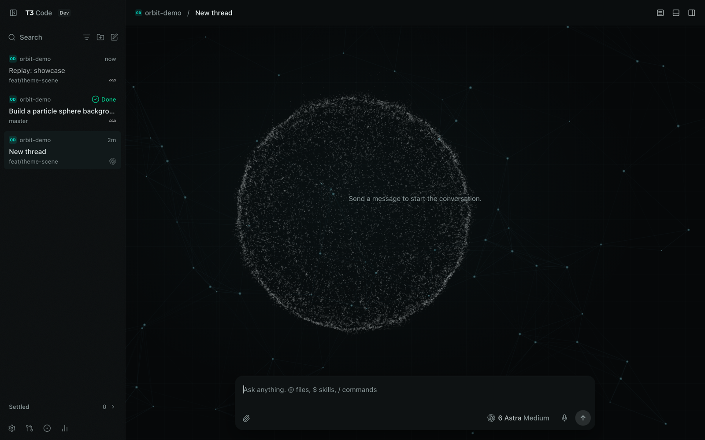
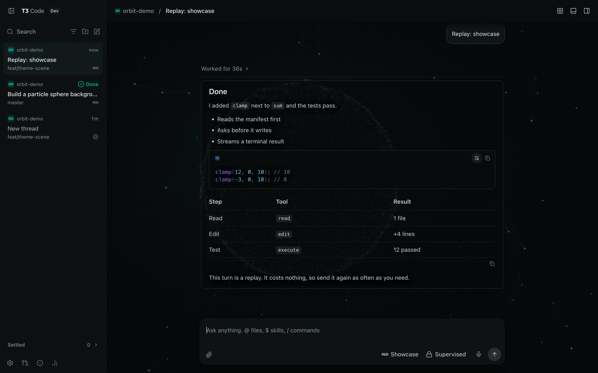

# Obsidian Orbit

Un tema oscuro para [T3 Code](https://github.com/pingdotgg/t3code). Detrás del chat gira una esfera de partículas en 3D y una red de nodos cian que sigue al ratón. Las respuestas van sobre paneles de vidrio para que se lean bien encima de la escena.





## Qué incluye

| Archivo               | Para qué sirve                                                         |
| --------------------- | ---------------------------------------------------------------------- |
| `obsidian-orbit.json` | Colores y CSS del tema: base grafito, acento cian y paneles de vidrio. |
| `obsidian-orbit.html` | La escena animada: la esfera de Spline y la red de partículas.         |

## Requisitos

- **Para la escena animada:** T3 Code compilado desde la rama [`feat/theme-scene`](https://github.com/victorcode1/t3code/tree/feat/theme-scene). Esa rama añade las escenas de tema, que el T3 Code oficial todavía no tiene.
- **Con el T3 Code oficial:** el tema funciona igual, pero sin la escena: verás los colores y un brillo cian suave de fondo.
- La escena descarga el runtime de Spline desde internet. Sin conexión solo se ve la red de partículas.

## Instalación

1. Descarga el tema:

   ```sh
   git clone https://github.com/victorcode1/obsidian-orbit.git
   cd obsidian-orbit
   ```

2. Publica el tema en tu entorno de T3 Code. Este comando lo copia a la carpeta de temas y lo activa:

   ```sh
   t3 theme set ./obsidian-orbit.json --id obsidian-orbit
   ```

3. Copia la escena junto al tema. En una instalación normal la carpeta es `~/.t3/userdata/themes/`:

   ```sh
   cp obsidian-orbit.html ~/.t3/userdata/themes/
   ```

4. Pon T3 Code en modo oscuro. La escena aparece en unos segundos, sin reiniciar.

### Si usas otra carpeta de datos

Si arrancas T3 Code con `--home-dir` o `--base-dir`, usa esa misma carpeta en los dos pasos:

```sh
t3 theme set ./obsidian-orbit.json --id obsidian-orbit --base-dir <carpeta>
cp obsidian-orbit.html <carpeta>/userdata/themes/
```

### Solo los colores

Si no quieres la escena, importa `obsidian-orbit.json` desde **Ajustes → Apariencia → Añadir tema**. Así tienes los colores y el brillo de fondo, pero no la escena, porque esa solo funciona con temas publicados en el entorno.

## Desinstalar

Borra los dos archivos de la carpeta de temas y elige otro tema:

```sh
rm ~/.t3/userdata/themes/obsidian-orbit.json ~/.t3/userdata/themes/obsidian-orbit.html
t3 theme set t3-code
```

## Seguridad

T3 Code carga la escena en un marco aislado con origen opaco y solo con permiso para ejecutar scripts. La escena no puede leer T3 Code, tu sesión, tus archivos ni el almacenamiento del navegador. Lo único que recibe es la posición del puntero.

## Rendimiento

La esfera usa WebGL y la red un canvas, y las dos se redibujan mientras la ventana está visible. En portátiles eso consume algo de batería. Con **Reducir movimiento** activado en el sistema, la red se queda quieta.

## Editar el tema

| Archivo             | Contenido                                                                                      |
| ------------------- | ---------------------------------------------------------------------------------------------- |
| `src/colors.json`   | Colores por función: texto, superficies, terminal, código y barra lateral.                     |
| `src/theme.css`     | Fondo, paneles de vidrio y detalles, con los selectores estables de T3.                        |
| `src/scene.html`    | La escena. Recibe el puntero de T3 Code como mensajes `t3-theme-scene:pointer`.                |
| `scripts/build.mjs` | Genera los archivos instalables y comprueba el contraste, los colores y los límites de tamaño. |

Necesitas Node.js 18 o posterior. No hay dependencias que instalar.

```sh
npm run build   # genera obsidian-orbit.json y obsidian-orbit.html
npm run check   # comprueba que estén al día y sean válidos
```

## Licencia

MIT. T3 Code pertenece a sus autores; este tema es un proyecto independiente.
